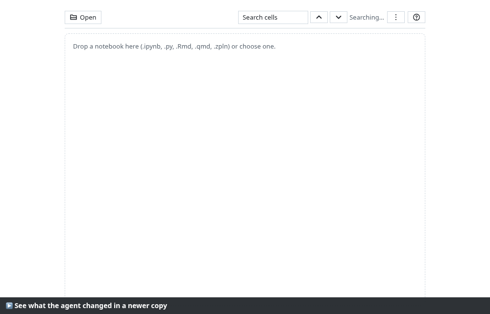
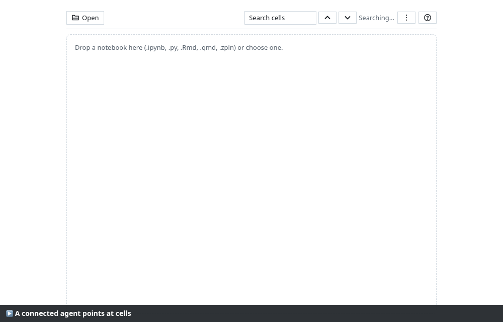
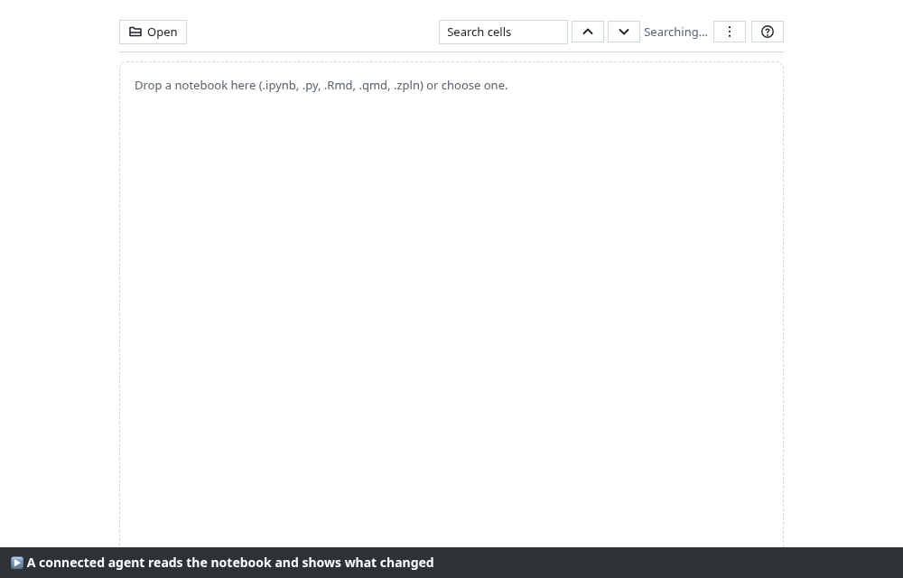
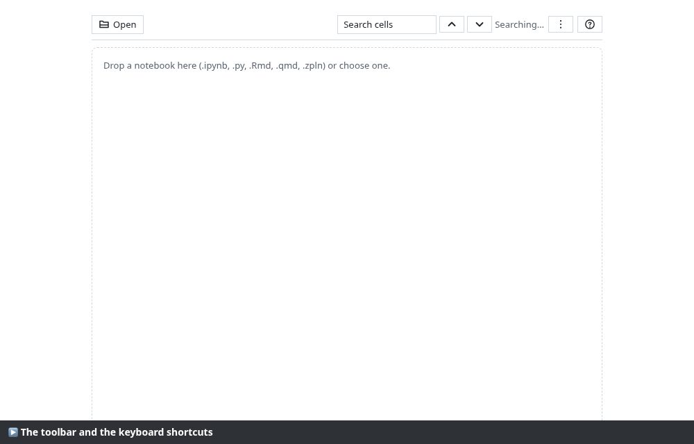
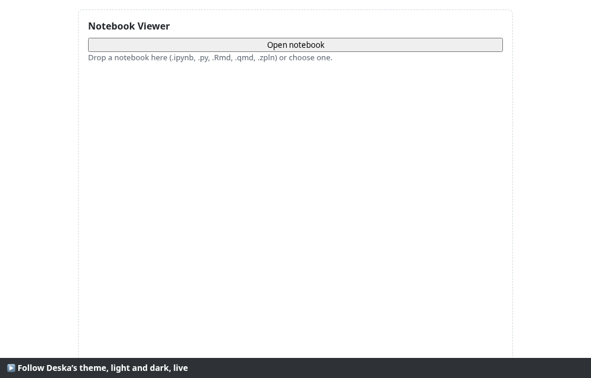
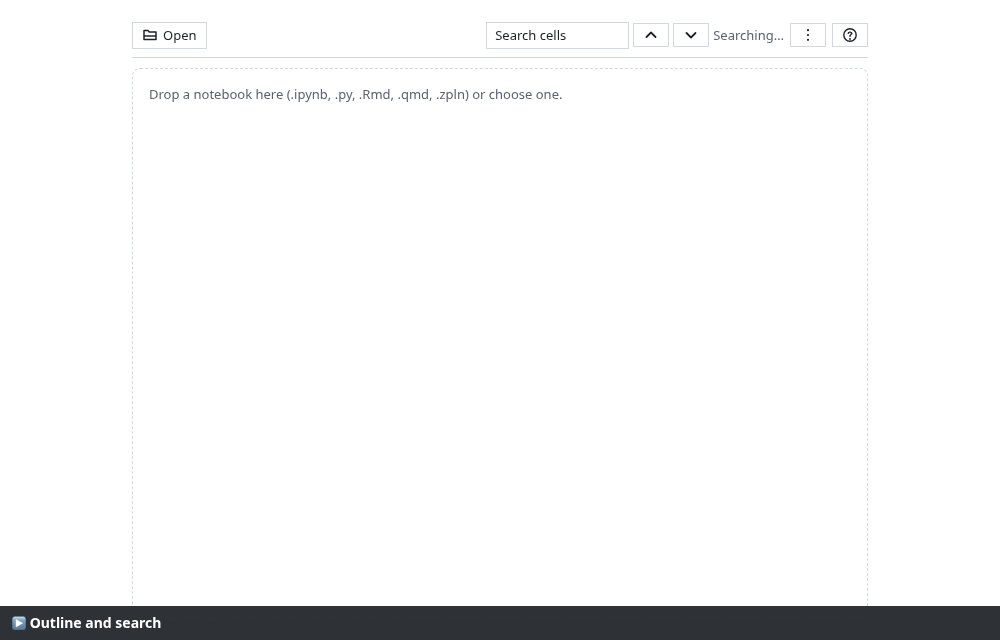
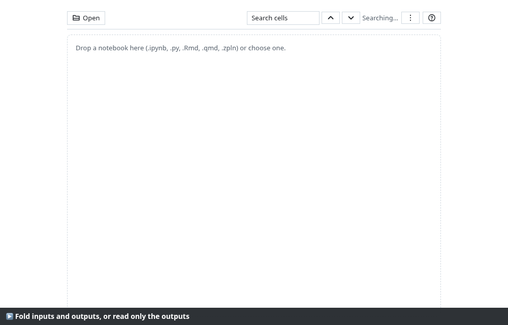
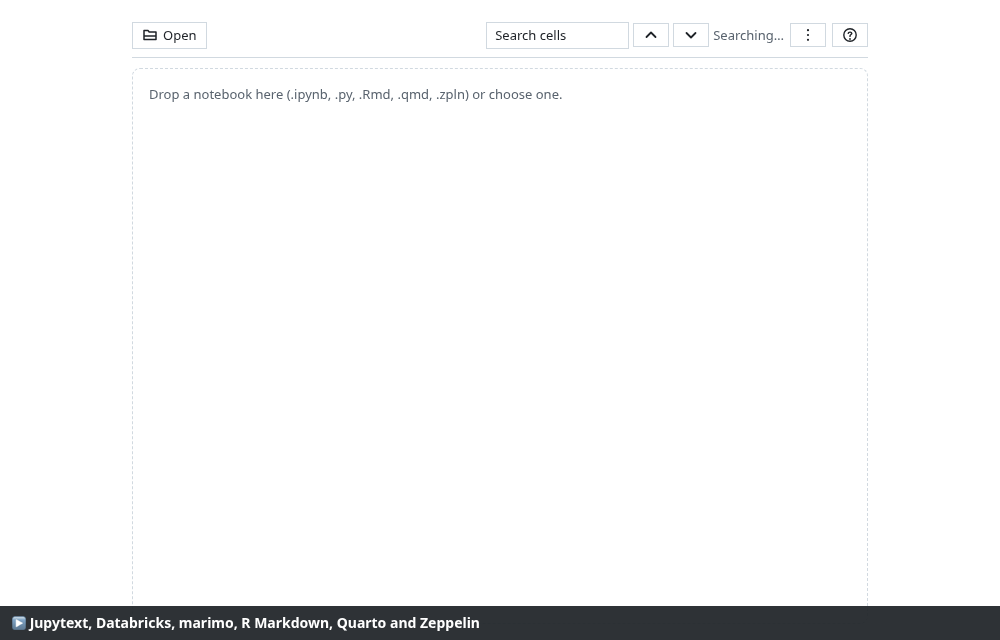

# Notebook Viewer for Deska

[](https://github.com/135Andres/jupyter-deska-panel/actions/workflows/ci.yml)

A [Deska](https://deska.dev) community panel for **reading notebooks** while a
coding agent edits and runs them. Drop a notebook on the panel and read it with
every output rendered, see what changed since the last copy, and let the agent
point you at the cell that matters.

Offline, read-only, and it never runs anything from the notebook.


<sub>Every animation on this page is a recorded, self-checking walkthrough. Each
step asserts what it shows, and the caption turns green only when the check
passes. See [docs/recordings](docs/recordings/RESULTS.md).</sub>

## What it does

| | |
| --- | --- |
| **Rich outputs** | HTML tables, PNG, JPEG, SVG, Markdown with LaTeX (KaTeX), streams and tracebacks with ANSI colours. Code is highlighted for Python, R, Julia, Scala and SQL. Plotly and other interactive outputs show their static image, or a placeholder row. |
| **What changed** | Open a newer copy of the same notebook and the cells whose source or outputs changed are marked. Deleted cells appear as a row where they were. The **Changed** filter shows only those. |
| **Agent actions** | With the `agent` permission, the coding agent of a connected task can `scroll_to_cell`, `highlight_cell`, `summarize_changes`, `get_cell`, `get_outline`, `find_cells`, `list_errors` and `set_view`. |
| **Toolbar and keys** | A compact fixed toolbar with icons: Open, search with a counter, outline, **Changed** filter, fold and **Outputs only**. Under 560 px the secondary controls move into a menu. Keyboard shortcuts, listed with `?`. |
| **Navigate** | An outline from the Markdown headings, plus search across sources and text outputs, both working through the virtualized list. |
| **Read** | Fold inputs or outputs, use **Outputs only**, scroll wide tables inside their own box, and see the execution count and time of each cell. |
| **Copy** | Copy a cell's source, or a PNG output as an image. |
| **Formats** | Jupyter `.ipynb` (nbformat 4.0 to 4.5: Jupyter, JupyterLab, Colab, Kaggle, VS Code), Jupytext percent `.py`, Databricks source `.py`, marimo `.py`, R Markdown `.Rmd`, Quarto `.qmd`, and Zeppelin `.zpln` with saved outputs. |
| **Big notebooks** | Cells are virtualized: 10,000 cells open in about 0.13 s with no long task, and about 15 are mounted at a time. A hidden panel pauses indexing and search. A slow host shows the empty state at once and an early agent call waits for the reopened notebook. |
| **Safe** | All HTML and SVG is sanitized with DOMPurify. Scripts, `on*` handlers and `javascript:` links never run. The panel makes no network requests at all. |
| **Follows Deska** | Light and dark theme, live, and English or Spanish. The last notebook reopens after a reload. |

## Showcase

### See what the agent changed

The agent edited one cell's source, re-ran another cell and deleted a third. The
newer copy marks the two changed cells in amber and shows a "1 deleted cell" row
where the third cell was.



### Let the agent point at cells and read them

These are the panel actions, called the way Deska calls them. Each input
and answer is checked against the schemas in `panel/panel.json`.



| Action | Kind | What it does |
| --- | --- | --- |
| `scroll_to_cell` | write | Scrolls to a cell by `id` or `index`. If a filter hides the cell, the filter is cleared first. A missing cell answers `not_found`. |
| `highlight_cell` | write | Scrolls to a cell and marks it for 1 to 30 seconds (3 by default). |
| `summarize_changes` | read | Lists the cells that changed or were deleted since the previous copy, each with its id, index, type and a one-line summary. |
| `get_cell` | read | Reads one cell by `id` or `index`: type, language, execution count, duration, source and outputs as text (stream, plain text, error traceback without ANSI colours); a PNG output comes as an image. Cut with a notice at the answer size limit. |
| `get_outline` | read | The Markdown headings with level, cell id and index, the same titles the outline shows. |
| `find_cells` | read | The panel's search: literal, case-insensitive, across sources and output text, returning matching cells with a fragment. |
| `list_errors` | read | The cells with an error output: id, index, `ename` and `evalue`. |
| `set_view` | write | Sets the **Changed** filter (`all` or `changed`) and the view mode (`all` or `outputs`), so the agent can show only what changed. Answers `conflict` when nothing changed. |

The reads and `set_view` are recorded below.



Actions only move the view or read what the panel already shows. They never edit
or run the notebook. If the person declines the permission, the panel keeps
working ([recording](docs/recordings/06-agent-declined.png)).

### Toolbar and keyboard shortcuts



| Key | What it does |
| --- | --- |
| `j` / `k` | Next / previous cell (cells hidden by a filter are skipped) |
| `/` | Focus the search |
| `n` / `N` | Next / previous search result |
| `c` | Toggle the **Changed** filter |
| `o` | Toggle **Outputs only** |
| `?` | List the shortcuts |
| `Esc` | Close the list or the menu |

Shortcuts never fire while you type in the search box.

### Light and dark, live



### Outline, search, fold and outputs only





### Seven notebook formats



### Hostile notebooks run nothing, and 10,000 cells scroll smoothly


## Install

Notebook Viewer is not in the Deska Marketplace yet. Until it is, you can load
it as a folder:

```sh
git clone https://github.com/135Andres/jupyter-deska-panel.git
cd jupyter-deska-panel
npm install
npm run build        # → dist/notebook-viewer/, with panel.json at its root
```

In Deska, open **Build a panel → Load a folder** and choose
`dist/notebook-viewer`. `npm run package` writes the zip that the Marketplace
takes, `dist/notebook-viewer.zip` (about 0.75 MB).

**Permissions:** `agent` lets a connected agent use the eight actions above, and
`clipboard-write` powers the copy buttons. The panel declares no network. Because
it declares `agent`, this panel ID can never declare network, embeds, `account`
or `open-url` (see [the Deska docs](https://deska.dev/docs/panel-actions)).

## Develop

```sh
npm run test            # unit tests (Vitest)
npm run lint            # ESLint
npm run typecheck       # tsc --noEmit
npm run test:e2e        # Playwright e2e in Chromium (E2E_PORT, 5191 by default)
npm run size            # 5 MB zipped, 20 MB unpacked, 500 files
npm run csp-lint        # nothing the sandbox refuses: eval, workers, WebAssembly
npm run validate:deska  # the examples repository's package checks, plus the agent rules
npm run check:deska     # loads the built panel in the examples repository's preview host
npm run record          # re-records docs/recordings (all walkthroughs, self-checking)
npm run screenshots     # the five Marketplace screenshots in panel/screenshots
```

`validate:deska`, `check:deska` and `preview:deska` use a clone of
[deska-panels-examples](https://github.com/0xPasho/deska-panels-examples) next
to this folder. [AGENTS.md](AGENTS.md) explains how the repository is laid out,
and [PLAN.md](PLAN.md) explains what is built, why, and in which order.

## How it is tested

- **207 unit tests and 43 Playwright e2e tests.** Together they cover the 8
  acceptance criteria of 0.1, the agent actions against the manifest schemas,
  copying, every format and the live theme.
- **14 recorded walkthroughs** in [docs/recordings](docs/recordings/RESULTS.md).
  They run the [manual test checklist](docs/manual-test.md) and the feature list
  in Chromium, with a double of the Deska SDK. Each scenario has a full `.webm`
  video and an animated PNG.
- **The examples repository's checks.** `validate:deska` checks the package and
  `check:deska` loads the panel under Deska's sandbox policy, in light and dark.

The walkthroughs found two bugs that the unit tests had missed. Both are fixed in
0.5.1:

- In dark theme, code blocks kept their light background
  ([before](docs/recordings/before/02-theme-bug.png)).
- The notebook header was missing.

**Not covered yet:** a run inside the Deska app itself, which needs a person. See
[docs/manual-test.md](docs/manual-test.md).

## Changelog

See [CHANGELOG.md](CHANGELOG.md).

## License

MIT. See [LICENSE](LICENSE). Third-party libraries and their licenses are in
[THIRD_PARTY_NOTICES.md](THIRD_PARTY_NOTICES.md). "Jupyter" is a trademark of
NumFOCUS and Project Jupyter, used here only to say which notebooks the panel
reads. Every fixture is synthetic.
