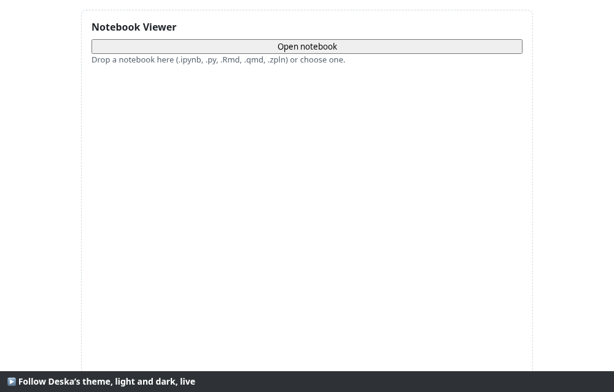
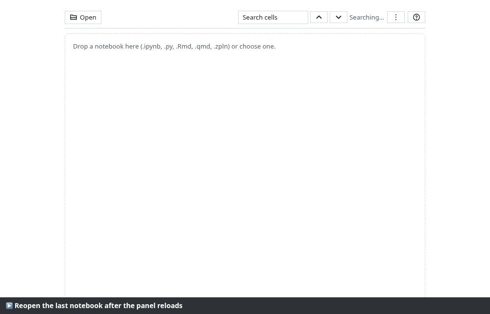
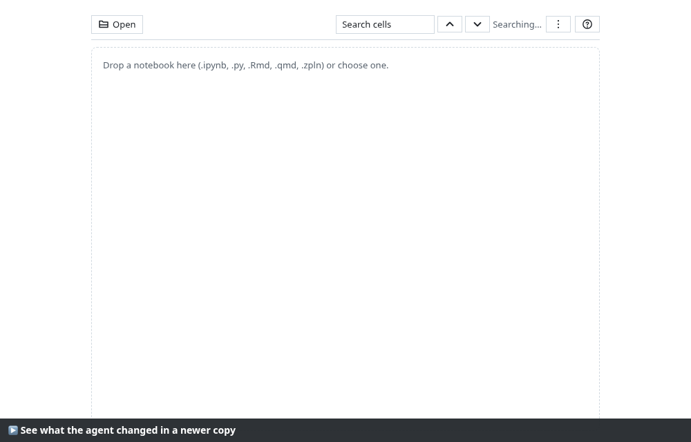
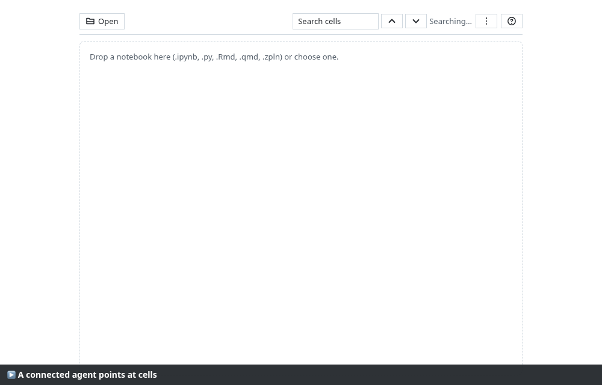
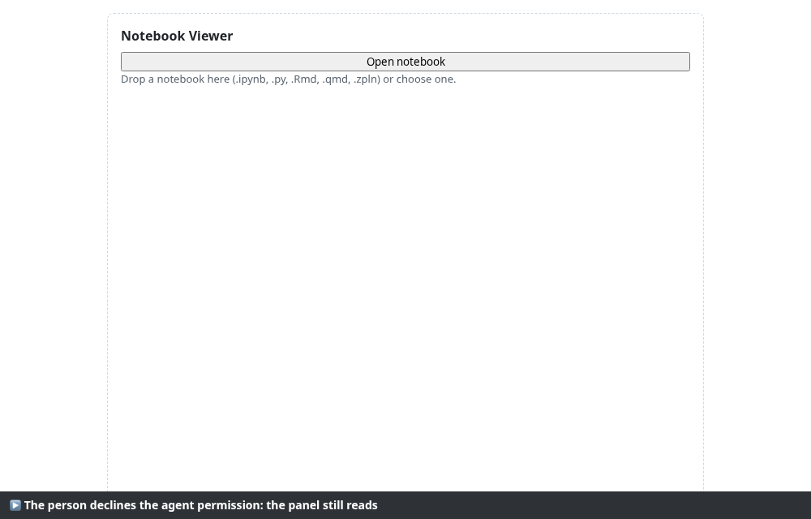
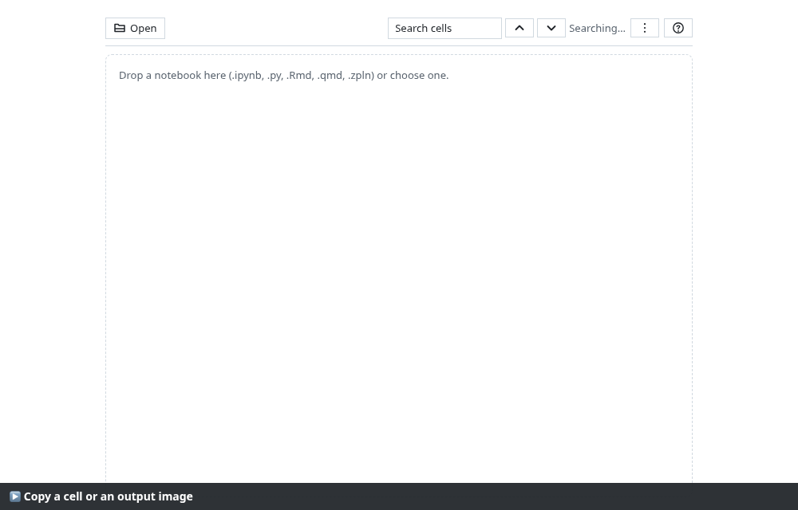
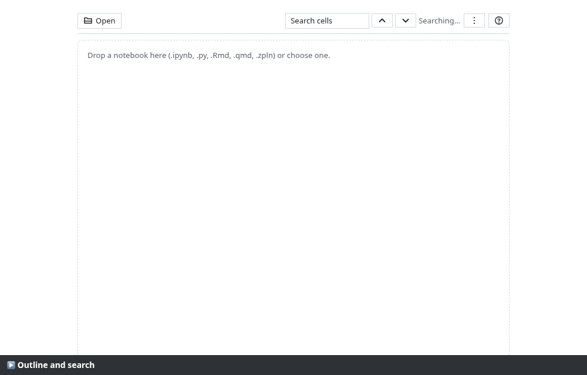
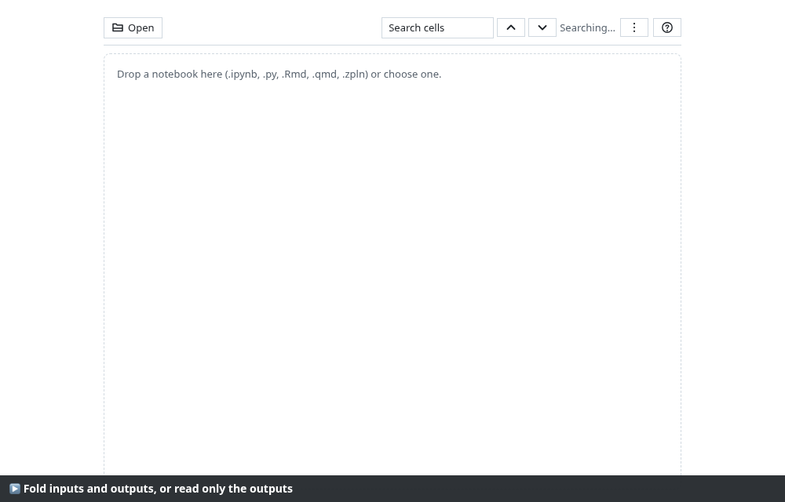
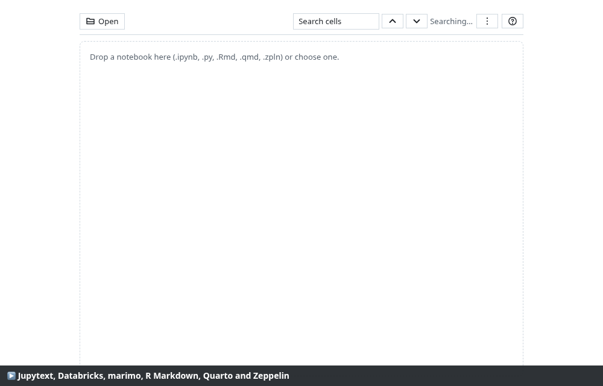

# Recorded walkthroughs

Run by `node scripts/showcase/record.mjs` on 2026-11-03: Chromium 156.0.8078.4, Node v24.22.1, Intel(R) Core(TM) i7-8850H CPU @ 2.60GHz, 31 GB.
The panel runs on the Vite dev server with a double of the Deska SDK (theme, storage, files, agent, clipboard).
Every step asserts what it shows; a failed step turns the caption red and stops the scenario.
Each scenario has a full video (`.webm`) and an animated PNG of its steps (`.png`, plays inline on GitHub).

| Scenario | manual-test.md | Steps | Result | Recording |
| --- | --- | --- | --- | --- |
| Open a notebook by dropping it on the panel | Steps 1 and 2 | 8/8 | ✓ pass | [video](01-open-notebook.webm) · [steps](01-open-notebook.png) |
| Follow Deska’s theme, light and dark, live | Step 3 | 4/4 | ✓ pass | [video](02-theme.webm) · [steps](02-theme.png) |
| Reopen the last notebook after the panel reloads | Step 4 | 3/3 | ✓ pass | [video](03-reload.webm) · [steps](03-reload.png) |
| See what the agent changed in a newer copy | Step 5 | 5/5 | ✓ pass | [video](04-what-changed.webm) · [steps](04-what-changed.png) |
| A connected agent points at cells | Step 6 | 7/7 | ✓ pass | [video](05-agent-actions.webm) · [steps](05-agent-actions.png) |
| The person declines the agent permission: the panel still reads | Step 7 | 3/3 | ✓ pass | [video](06-agent-declined.webm) · [steps](06-agent-declined.png) |
| Copy a cell or an output image | — | 3/3 | ✓ pass | [video](07-copy.webm) · [steps](07-copy.png) |
| Outline and search | — | 4/4 | ✓ pass | [video](08-navigate.webm) · [steps](08-navigate.png) |
| Fold inputs and outputs, or read only the outputs | — | 4/4 | ✓ pass | [video](09-fold-and-outputs.webm) · [steps](09-fold-and-outputs.png) |
| Jupytext, Databricks, marimo, R Markdown, Quarto and Zeppelin | — | 7/7 | ✓ pass | [video](10-formats.webm) · [steps](10-formats.png) |
| A hostile notebook runs nothing | — | 4/4 | ✓ pass | [video](11-hostile.webm) · [steps](11-hostile.png) |
| 10,000 cells open and scroll without freezing | — | 6/6 | ✓ pass | [video](12-large.webm) · [steps](12-large.png) |

## Open a notebook by dropping it on the panel

- ✓ The panel loads and shows the empty state
- ✓ Drop demo-sales.ipynb onto the panel
- ✓ The header shows file name, kernel, language and cell count — Quarterly sales review · python3 · python · 13 cells
- ✓ Markdown with LaTeX (KaTeX) and highlighted code — 4 formulas rendered
- ✓ A pandas table and the execution time of each cell
- ✓ A matplotlib PNG and an SVG chart
- ✓ A stderr warning and a traceback with ANSI colours
- ✓ No uncaught errors and no console errors

## Follow Deska’s theme, light and dark, live

- ✓ Light theme: light background, dark text, light code blocks
- ✓ Deska switches to dark: code blocks, text and errors follow
- ✓ Back to light
- ✓ No uncaught errors and no console errors

## Reopen the last notebook after the panel reloads

- ✓ Open demo-sales.ipynb
- ✓ Reload the panel: the notebook reopens by itself, at the top
- ✓ No uncaught errors and no console errors

## See what the agent changed in a newer copy

- ✓ Open demo-sales.ipynb
- ✓ Drop a newer copy: one source and one output changed, one cell deleted — Marked in amber; the filter says Changed (2)
- ✓ Turn on "Changed": only the changed cells and the deleted row
- ✓ Back to "All"
- ✓ No uncaught errors and no console errors

## A connected agent points at cells

- ✓ summarize_changes before a second copy: nothing to compare — → {"available":false,"message":"No previous version to compare. Changes appear once the same notebook is opened 
- ✓ scroll_to_cell { id: "check" } (the failing assert) — → {"ok":true}
- ✓ highlight_cell { index: 6, seconds: 3 } (the PNG chart) — → {"ok":true}; the mark goes away by itself
- ✓ The highlight disappears after about 3 seconds
- ✓ A newer copy, then summarize_changes — → changed load, changed region, deleted warn
- ✓ scroll_to_cell to a cell that does not exist: not_found, the view stays — → {"ok":false,"error":"not_found"}
- ✓ No uncaught errors and no console errors

## The person declines the agent permission: the panel still reads

- ✓ Permission `agent` declined; open demo-sales.ipynb
- ✓ Search and the Changed filter keep working
- ✓ No uncaught errors and no console errors

## Copy a cell or an output image

- ✓ Copy the source of a code cell — The clipboard holds the cell source
- ✓ Copy the PNG chart as an image — image/png, 14,953 bytes
- ✓ No uncaught errors and no console errors

## Outline and search

- ✓ Open the outline built from the Markdown headings
- ✓ Jump to "4. Checks"
- ✓ Search "revenue" and walk the results — Previous Next 2 / 4
- ✓ No uncaught errors and no console errors

## Fold inputs and outputs, or read only the outputs

- ✓ Fold all: each cell keeps its first line
- ✓ Unfold all, then "Outputs only"
- ✓ Large tables scroll inside their own box
- ✓ No uncaught errors and no console errors

## Jupytext, Databricks, marimo, R Markdown, Quarto and Zeppelin

- ✓ Jupytext percent: jupytext-percent.py — 4 cells
- ✓ Databricks source: databricks-source.py — 4 cells
- ✓ marimo: marimo-app.py — 4 cells
- ✓ R Markdown: rmarkdown-report.Rmd — 5 cells
- ✓ Quarto: quarto-doc.qmd — 4 cells
- ✓ Zeppelin (with saved outputs): zeppelin-note.zpln — 5 cells
- ✓ No uncaught errors and no console errors

## A hostile notebook runs nothing

- ✓ Open a notebook with <script>, on* handlers, javascript: links and SVG scripts
- ✓ Click every link in the outputs
- ✓ Nothing ran: no script, handler or link fired — execution spy: [] — 0 script/iframe/object/embed nodes
- ✓ No uncaught errors and no console errors

## 10,000 cells open and scroll without freezing

- ✓ Open a 10,000-cell notebook (1.6 MB) — first cell after 1092 ms; 14 cells in the DOM
- ✓ Scroll to 25% — 281 ms, 29 cells mounted
- ✓ Scroll to 50% — 260 ms, 29 cells mounted
- ✓ Scroll to 75% — 262 ms, 29 cells mounted
- ✓ Scroll to 100% — 263 ms, 17 cells mounted
- ✓ No uncaught errors and no console errors
